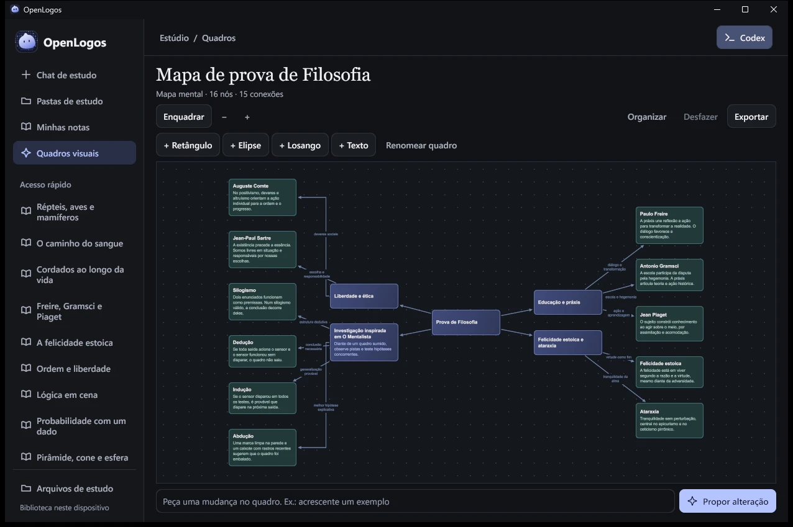

<p align="center">
  
</p>

<h1 align="center">OpenLogos</h1>

<p align="center">
  Estude um assunto com IA. Transforme o que aprendeu em um mapa que você pode editar.
</p>

<p align="center">
  <strong><a href="https://github.com/galvaogg/OpenLogos/releases/latest/download/OpenLogos.exe">Baixar para Windows 11 x64</a></strong> · <a href="https://github.com/galvaogg/OpenLogos/releases">Versões</a>
</p>

<p align="center">
  
</p>

## Começar

Baixe e abra `OpenLogos.exe` no Windows 11 x64. O aplicativo é portátil. As lições de exemplo, a edição manual e a exportação funcionam offline.

Para gerar lições e quadros, instale um dos CLIs, faça login no terminal e escolha o agente no canto superior direito do app.

| Agente | Login |
| --- | --- |
| [Codex](https://developers.openai.com/codex/cli) | `codex login` com conta ChatGPT |
| [Claude Code](https://code.claude.com/docs/en/setup) | `claude auth login` com assinatura Claude |

O app usa a sessão existente do CLI e consome a cota da assinatura. Quando você solicita uma geração, o agente recebe o pedido, os anexos visíveis e o quadro em revisão. Quadros, notas, pastas, preferências e progresso ficam em `%APPDATA%\OpenLogos\library.json`.

## Quadros visuais

Abra **Quadros visuais** e escolha **Mapa mental**, **Fluxograma** ou **Linha do tempo**. Comece com **Novo quadro em branco**, descreva o quadro que a IA deve gerar ou use **Criar exemplo offline**.

- Adicione retângulos, elipses, losangos e textos avulsos. Arraste para posicionar e selecione para editar. Para criar uma seta, selecione o nó de origem, clique em **Conectar** e escolha o destino. Use **Conexões** para editar os rótulos e remover setas.
- Use **Enquadrar** para ver o mapa, **Focar nó** para ler um elemento selecionado e **Desfazer** para voltar uma edição. O app salva o quadro ao concluir cada alteração e permite reabri-lo em **Quadros visuais**.
- Peça uma mudança ao agente, como “Inclua um exemplo concreto abaixo de Hipótese”. Revise e escolha **Aplicar proposta** ou **Descartar**.
- Use **Exportar** para salvar em `Documentos\OpenLogos\Estudos`. Abra o arquivo `.excalidraw` no Excalidraw para editar formas, textos e setas. [Formato de cena do Excalidraw](https://plus.excalidraw.com/docs/sdk/codebase/json-schema)

## Estudo e revisão

O **Chat de estudo** transforma um tema em leitura, exercícios com dicas e resumo. Organize as lições em **Pastas de estudo**, escreva notas nos cards e volte ao card original por **Minhas notas**. No leitor, **Criar mapa** leva o conteúdo da lição ao agente visual como anexo removível.

<p align="center">
  
</p>

### Comandos do chat

Digite `/` para ver o menu ou envie um pedido direto.

| Comando | Exemplo |
| --- | --- |
| `/mapa` | `/mapa relações entre a Lua, o Sol e as marés` |
| `/fluxo` | `/fluxo como testar uma hipótese com controle` |
| `/linha-do-tempo` | `/linha-do-tempo principais marcos da exploração lunar` |
| `/licao` | `/licao fases da Lua` |
| `/aprofundar` | `/aprofundar por que azul e vermelho aparecem no céu` |
| `/praticar` | `/praticar frações equivalentes` |
| `/revisar` | `/revisar leis de Newton` |
| `/questoes` | `/questoes questões do ENEM sobre probabilidade` |

### Buscar questões no Google

Configure o Google Agent Search para acervos públicos e use `/questoes` ou um pedido como “Busque questões de probabilidade do ENEM”. O app mostra a origem de cada exercício e inclui links confirmados no Markdown exportado. [Configurar a busca Google](docs/busca-google.md)

**Arquivos de estudo** abre os arquivos Markdown de `Documentos\OpenLogos\Estudos`. Selecione um arquivo para anexá-lo ao chat. **Exportar Markdown**, no leitor, salva leitura, dicas, gabarito e referências. Cada exportação gera uma cópia.

## Plataformas

| Plataforma | Disponibilidade |
| --- | --- |
| Windows 11 x64 | Executável portátil testado e disponível no GitHub Releases. |
| macOS e Linux | A interface e a entrada do app são específicas do Windows. Os builds dependem de um port. |

## Compilar no Windows

Use Go 1.26.3 no Windows.

```powershell
go test ./...
go build -trimpath -ldflags '-H=windowsgui -s -w' -o dist/OpenLogos.exe .
```

[Medições e validação da v0.1.0](docs/validacao-v0.1.0.md)
