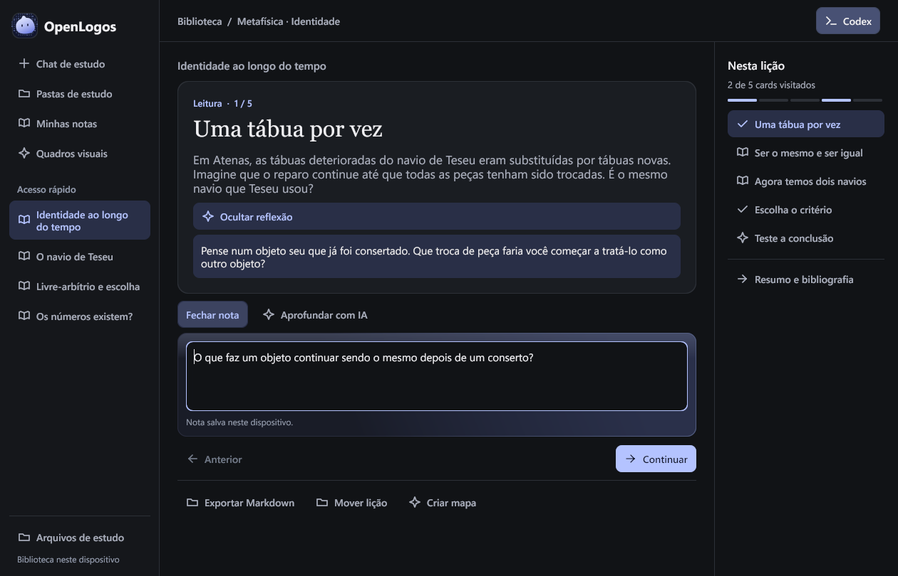

<p align="center">
  
</p>

<h1 align="center">OpenLogos</h1>

<p align="center">
  Estude um assunto com IA. Transforme o que aprendeu em um mapa que você pode editar.
</p>

<p align="center">
  <strong>Windows 11</strong> · Go + Gio · Codex e Claude Code
</p>

<p align="center">
  
</p>

## Quadros visuais

Abra **Quadros visuais** e escolha **Mapa mental**, **Fluxograma** ou **Linha do tempo**. Escreva um pedido ou use **Criar exemplo offline** para conhecer o quadro.

- Arraste os nós, mova a área do quadro e use o zoom. Selecione um nó para editar o título e o detalhe.
- Peça uma mudança ao agente, como “Inclua um exemplo concreto abaixo de Hipótese”. Revise a proposta no quadro e escolha **Aplicar proposta** ou **Descartar**. **Desfazer** recupera a versão anterior à última alteração aplicada, edição de texto ou reorganização.
- Use **Exportar** para salvar em `Documentos\OpenLogos\Estudos`. O arquivo `.excalidraw` abre no Excalidraw com formas, textos e conexões editáveis. [Formato de cena do Excalidraw](https://plus.excalidraw.com/docs/sdk/codebase/json-schema)

## Estudo e revisão

O **Chat de estudo** transforma um tema em leitura, exercícios com dicas e resumo. Organize as lições em **Pastas de estudo**, escreva notas nos cards e volte ao card original por **Minhas notas**. No leitor, **Criar mapa** leva o conteúdo da lição ao agente visual como anexo removível.

<p align="center">
  
</p>

### Comandos do chat

Digite `/` para ver o menu ou envie um pedido direto.

| Comando | Exemplo |
| --- | --- |
| `/mapa` | `/mapa relações entre a Lua, o Sol e as marés` |
| `/fluxo` | `/fluxo como testar uma hipótese com controle` |
| `/linha-do-tempo` | `/linha-do-tempo principais marcos da exploração lunar` |
| `/licao` | `/licao fases da Lua` |
| `/aprofundar` | `/aprofundar por que azul e vermelho aparecem no céu` |
| `/praticar` | `/praticar frações equivalentes` |
| `/revisar` | `/revisar leis de Newton` |

## Rodar no Windows

Abra `dist\OpenLogos.exe` após compilar. Para gerar com IA, instale um dos CLIs, faça login no terminal e escolha o agente no canto superior direito do app.

| Agente | Login |
| --- | --- |
| [Codex](https://developers.openai.com/codex/cli) | `codex login` com conta ChatGPT |
| [Claude Code](https://code.claude.com/docs/en/setup) | `claude auth login` com assinatura Claude |

O app usa a sessão existente do CLI e consome a cota da assinatura. O pedido, os anexos visíveis e o quadro em revisão só são enviados ao agente ao solicitar geração. Quadros salvos, notas, pastas, preferências e progresso ficam em `%APPDATA%\OpenLogos\library.json`. Os exemplos, a edição do quadro e a exportação funcionam offline.

### Compilar

Use Go 1.26.3 no Windows.

```powershell
go test ./...
go build -trimpath -ldflags '-H=windowsgui -s -w' -o dist/OpenLogos.exe .
```

**Arquivos de estudo** abre os arquivos Markdown de `Documentos\OpenLogos\Estudos`. Selecione um arquivo para anexá-lo ao chat. **Exportar Markdown**, no leitor, salva leitura, dicas, gabarito e referências. Cada exportação gera uma cópia.
